# Perf Clinic: performance notes (Part B)

## How I measured

Chrome 154, 1440x900, Incognito (no extensions). "My Chrome" numbers come from my own recordings in the DevTools Performance, Network and Lighthouse panels, without CPU throttling; the screenshots are in `docs/perf/before` and `docs/perf/after`. "4x CPU" numbers come from repeatable automated runs (Playwright + Chrome DevTools Protocol, 4x CPU slowdown, median of 3 runs) that I used to re-verify each fix.

## Summary

| #   | Problem                                    | Before                                  | After                           |
|-----|--------------------------------------------|-----------------------------------------|---------------------------------|
| 1   | Blank screen on load                       | first frame 18.8 s (my Chrome)          | content at ~0.4 s (my Chrome)   |
| 2   | Typing freezes the page                    | one keypress = 12.42 s task (my Chrome) | no long tasks while typing      |
| 3   | Page busy for seconds after it appears     | main-thread time 23,627 ms (my Chrome)  | 426 ms (my Chrome)              |
| 4   | Scrolling is janky                         | scroll handlers 18,980 ms (4x CPU)      | 17.7 ms (4x CPU)                |
| 5   | Text fitting forces layout (resize freeze) | 5,686 forced layouts (4x CPU)           | 4 (4x CPU)                      |
| 6   | Hero image is 4.2 MB                       | 4,271 kB (my Chrome)                    | 208 kB (my Chrome)              |
| 7   | Card heights cause layout thrash           | 576 forced layouts, 4,319 ms (4x CPU)   | 0                               |
| 8   | Wheel scroll waits for JavaScript          | 694 ms wheel delay (4x CPU)             | 83 ms (4x CPU)                  |
| 9   | Hover tooltip lags                         | 29.6 ms per mouse move (4x CPU)         | 0.94 ms (4x CPU)                |
| 10  | Live ticker leaks after closing            | 5 timers left running, +1,611 DOM nodes | 0 timers, +15 nodes             |
| 11  | localStorage written once per row          | 2,000 writes per 10 searches            | 10 writes                       |
| 12  | Oversized and duplicate avatars            | 12 files, 153-169 kB each (my Chrome)   | 6 files, ~1 kB each (my Chrome) |
| 13  | Unused render-blocking theme.css           | 327 kB (my Chrome)                      | removed                         |
| 14  | Alert strip animation causes layout        | 93 layouts per second while idle        | 0                               |
| 15  | Web font found late                        | requested at 1,634 ms (4x CPU)          | at 20 ms                        |
| 16  | Slow time formatting                       | 1,369 ms per 2,000 rows (4x CPU)        | 2.4 ms                          |
| 17  | Layout shift after my first fix            | CLS 0.049 (Lighthouse mobile)           | 0                               |

Lighthouse performance score (my Chrome, Incognito): 61 → 98.

Verified the same on Firefox and Edge as well.

Entries 1-6, 12 and 13 are what I saw myself in Chrome DevTools (screenshots below). Entries 7-11 and 14-17 were measured in the automated runs.

## Problems

### 1. Blank screen on load
- Symptom: When I opened the page it stayed empty for almost 19 seconds before anything showed.
- How I found it: Performance panel, record and reload. The Frames row showed one frame of 18.8 seconds, and FCP only appeared at about 19 seconds.

  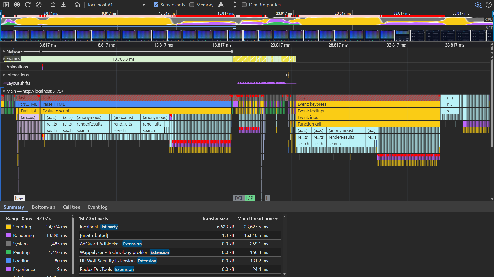
  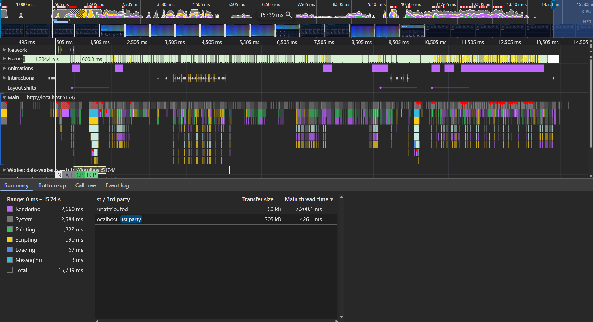
- Root cause: The browser was still reading the HTML when it ran the scripts, and the scripts built 100,000 events and rendered the whole list before the page could be drawn.
- Fix: Both scripts use `defer`. `config.js` no longer builds the 100,000 events while the HTML is parsed; the page shell paints first and the data is built afterwards (in a Web Worker, see #3).
- Before / after: First frame 18.8 s → content visible at about 0.4 s (my Chrome). FCP 20,160 ms → 1,396 ms (4x CPU). Lighthouse 61 → 98.

### 2. Typing in the search box freezes the page
- Symptom: After typing one letter in the search box, nothing happened for many seconds.
- How I found it: Performance panel while typing. One keypress made a single task of 12.42 seconds. Bottom-up showed the sort function with `new Date` (app.js:86), `JSON.stringify` (app.js:85) and Layout at the top.

  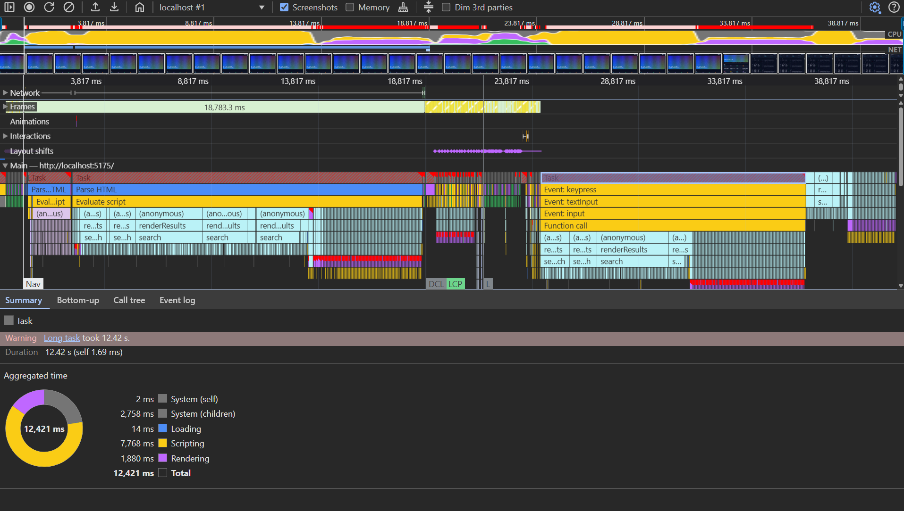
  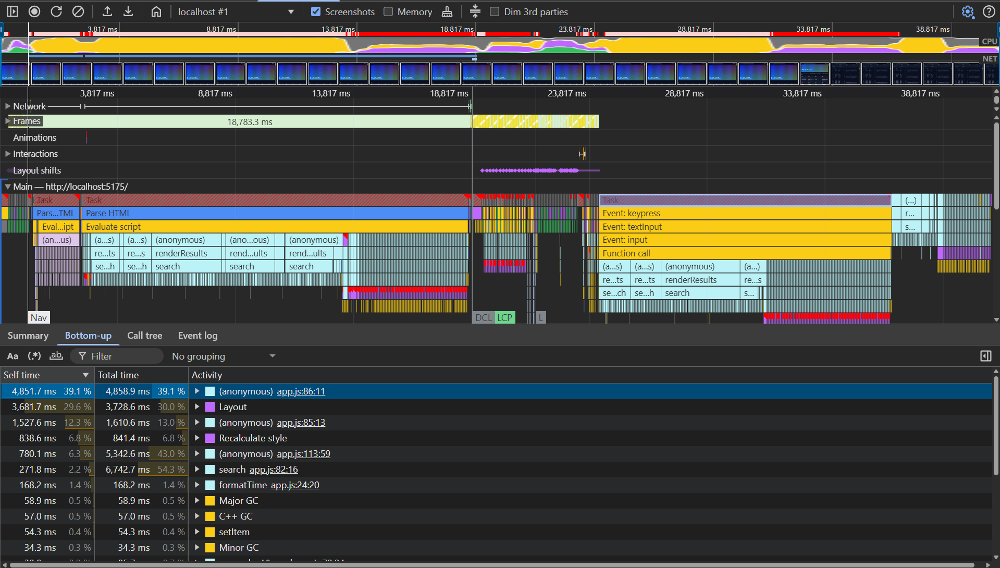
- Root cause: On every key the code turned all 100,000 events into text, sorted them again with two Date objects per comparison, and redrew the list.
- Fix: Events are sorted once by a numeric timestamp, the lowercase search text of each event is built once, and searching runs in a Web Worker. Input waits 150 ms after the last key. Results and order are identical to the original.
- Before / after: One keypress: 12.42 s long task → no long tasks while typing (my Chrome). Slowest keystroke 11,232 ms → 80 ms (4x CPU).

### 3. Page is busy for seconds after it appears
- Symptom: After my first fixes the page showed quickly, but for about 3 more seconds it did not react.
- How I found it: Performance panel on the fixed page. There was still one long task right after load where the data was built, and the Summary showed a lot of main-thread time.

  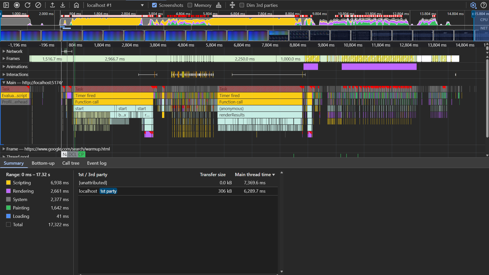
- Root cause: Even after the first paint, building and searching 100,000 events still ran on the main thread, the same thread that handles clicks and typing.
- Fix: Building the 100,000 events, sorting them, counting per agent and per minute, and searching all moved to a Web Worker (`js/data-worker.js`). The main thread only renders the 200 rows it gets back; an older search answer arriving late is ignored.
- Before / after: Main-thread time for load + typing + scrolling 23,627 ms → 426 ms (my Chrome). The ~3 s freeze after load is gone.

### 4. Scrolling the list is Broken
- Symptom: Scrolling the list stuttered and sometimes stopped for a moment.
- How I found it: Performance panel while scrolling. Every scroll event was a long task with red corners and many layout blocks.

  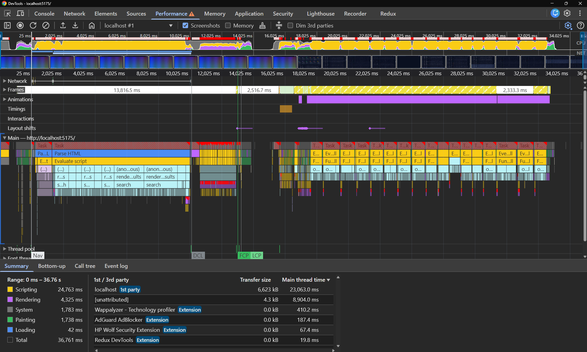
- Root cause: On every scroll event the code measured all 200 rows one by one and counted through all 100,000 events again.
- Fix: Scroll work runs at most once per frame (`requestAnimationFrame`), reads before writes. Row positions are measured once per render. Calls per minute are counted once. The progress bar uses `transform`.
- Before / after: Scroll handler time 18,980 ms → 17.7 ms, dropped frames 110 → 48, blocking time 19,238 ms → 25 ms (4x CPU).

### 5. Text fitting forces layout again and again
- Symptom: The page froze when the list was drawn and when I resized the window.
- How I found it: Performance panel. I zoomed in on the purple Layout blocks and Chrome showed a "Forced reflow" warning pointing to app.js line 116, where it reads `scrollWidth`.

  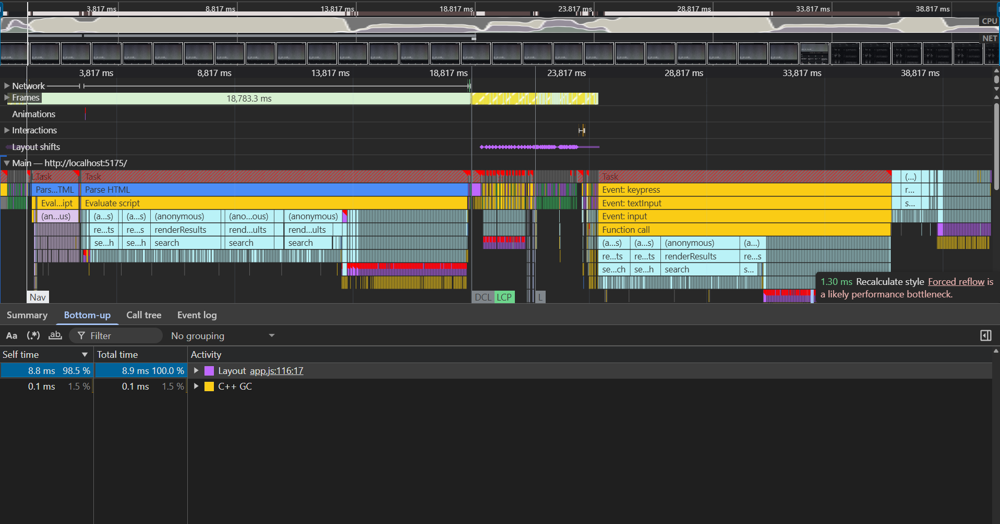
- Root cause: For each row it changed the font size and right away asked how wide the text was, so the browser had to recalculate the layout every time, many times per row.
- Fix: `fitSummaries` measures text with an off-screen canvas (`measureText`, no layout) and reads the column width once, then sets each row's size. Same sizes as before for all 200 rows.
- Before / after: Forced layouts during 4 window resizes 5,686 → 4, blocking time 7,845 ms → 58 ms (4x CPU).

### 6. Hero image is 4.2 MB
- Symptom: The big image at the top loaded slowly.
- How I found it: Network panel, sorted by size. hero.png was 4,271 kB.

  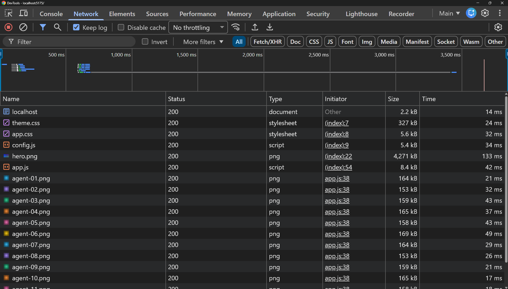
  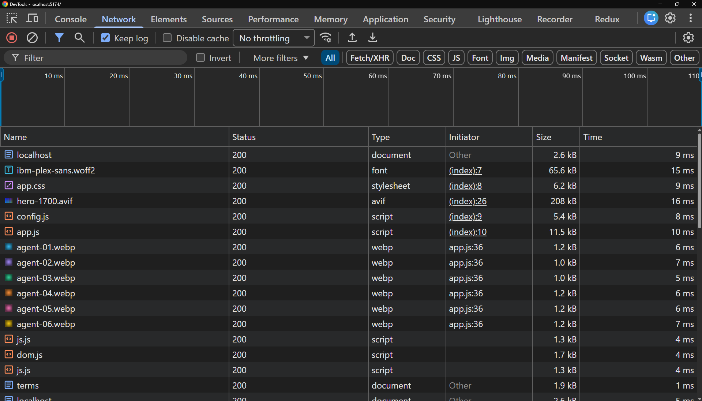
- Root cause: It was a huge lossless PNG, the same file for every screen size.
- Fix: `<picture>` with AVIF and WebP at 960 and 1700 px wide (`srcset` + `sizes`) and a JPEG fallback; width and height set; `fetchpriority="high"`.
- Before / after: 4,271 kB → 208 kB (my Chrome). Lighthouse mobile LCP 27.8 s → 2.0 s.

### 7. Agent cards cause layout thrash
- Symptom: The agent cards jumped while the page loaded.
- How I found it: Automated run, Performance trace during load: `equalizeCardHeights` ran 24 times with forced reflows.
- Root cause: It measured every card against every other card, and it did that again each time an image loaded.
- Fix: Equal card heights now come from CSS grid (`align-items: stretch` + `min-height: 220px`); `equalizeCardHeights` and its listeners are removed.
- Before / after: 576 forced layouts and 4,319 ms during load → 0 (4x CPU).

### 8. Wheel scroll waits for JavaScript
- Symptom: The mouse wheel felt sticky; the page moved late.
- How I found it: Automated run: wheel events waited for the main thread, and the listeners on the list were not passive. Lighthouse also lists non-passive listeners.
- Root cause: The wheel and touch listeners were not passive, so the browser had to wait for JavaScript before scrolling.
- Fix: The `wheel`, `touchstart` and `scroll` listeners are registered with `{ passive: true }`.
- Before / after: Median wheel delay 694 ms → 83 ms (4x CPU).

### 9. Hover tooltip lags behind the mouse
- Symptom: The tooltip trailed behind the mouse over the rows.
- How I found it: Automated run, Performance trace while moving the mouse over rows: each mouse move was a slow event in `showPreview`.
- Root cause: Every mouse move searched through all 100,000 events to find the row's event.
- Fix: A Map from id to event for the rows on screen; the tooltip moves with `transform`. It also hides on any scroll, so it never shows the wrong row.
- Before / after: 29.6 ms → 0.94 ms per mouse move (4x CPU).

### 10. Live ticker keeps running after it is closed
- Symptom: After opening and closing "Show live calls" a few times, the page got slower.
- How I found it: Automated run: after 5 open/close cycles the timers were still running and DOM nodes kept growing (the same thing the Performance monitor shows).
- Root cause: Closing the ticker never stopped its timer or removed its listeners, so every open added more.
- Fix: Closing clears the interval and removes the resize and keydown listeners (AbortController). No cache of every row ever shown.
- Before / after: After 5 open/close cycles: timers still running 5 → 0, DOM nodes added 1,611 → 15.

### 11. localStorage written once per row
- Symptom: Every search felt a little slower, and the saved data kept growing.
- How I found it: Automated run: counted the `setItem` calls during 10 searches and watched the stored list grow.
- Root cause: The code saved the whole list to localStorage once for every row, 200 times per search.
- Fix: Viewed ids are kept in a Set and written once per render, capped at 5,000.
- Before / after: 2,000 → 10 `setItem` calls for 10 searches (999 ms → 7 ms, 4x CPU).

### 12. Oversized and duplicate avatars
- Symptom: The page downloaded much more than it showed.
- How I found it: Network panel. 12 avatar PNGs of about 160 kB each for 48 px images, and half of them had exactly the same size as the other half.

  
  
- Root cause: 320 px images were used for a 48 px spot, and 6 files were copies of the other 6.
- Fix: Six 96 px WebP files (twice the 48 px display size), reused for all 24 cards, with width and height set.
- Before / after: 12 files of 153-169 kB → 6 files of about 1 kB (my Chrome). 1.94 MB → 6.8 kB in total.

### 13. Unused render-blocking theme.css
- Symptom: The page waited for a big stylesheet before showing anything.
- How I found it: Network panel showed theme.css at 327 kB. The Coverage check in the automated run showed 100% of it unused.

  
- Root cause: A utility stylesheet was linked in the head, but the page used none of its classes.
- Fix: Removed the `<link>` and the file.
- Before / after: 327 kB of CSS → 0 (my Chrome).

### 14. Alert strip animation runs layout every frame
- Symptom: The page was busy even when I did nothing.
- How I found it: Automated run: a 3-second idle trace showed layout and paint every frame caused by the alert strip.
- Root cause: The animation moved the strip with `left`, which makes the browser redo layout every frame.
- Fix: The keyframes animate `transform: translateX` instead of `left`, with the same distances; paused under `prefers-reduced-motion`.
- Before / after: 93 layouts per second while idle → 0 (4x CPU).

### 15. Web font found late
- Symptom: Text appeared late or changed after loading.
- How I found it: Network panel. Before, the font was not among the first requests, now it is the second request. The automated run measured when the request starts.

  
- Root cause: The browser only finds the font after reading the CSS and laying out text, and by default it hides text until the font arrives.
- Fix: `<link rel="preload" as="font" crossorigin>` and `font-display: swap`.
- Before / after: Font request starts at 1,634 ms → 20 ms (4x CPU).

### 16. Slow time formatting
- Symptom: Rendering the rows took longer than it should.
- How I found it: Automated run, CPU profile: `formatTime` had noticeable self time while searching.
- Root cause: `toLocaleTimeString` creates a date formatter for every row, but the time is already inside the timestamp string.
- Fix: Timestamps are UTC ISO strings, so `iso.slice(11, 19)` gives the same HH:MM:SS.
- Before / after: 1,369 ms → 2.4 ms for 2,000 calls (4x CPU).

### 17. Layout shift after my first fix
- Symptom: On a phone-sized screen, the "Recent tool calls" section jumped down when the cards appeared.
- How I found it: Lighthouse mobile in the automated run showed CLS 0.049 and pointed to that section.
- Root cause: When I delayed the rendering, the card area was empty at first, so the content below moved when the cards arrived.
- Fix: The agent cards render as soon as the page loads (counts are filled in later), so the sections below no longer jump.
- Before / after: Lighthouse mobile CLS 0.049 → 0.

## Lighthouse

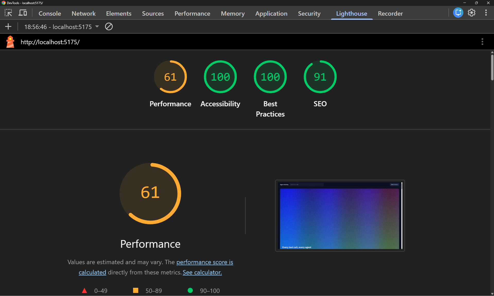
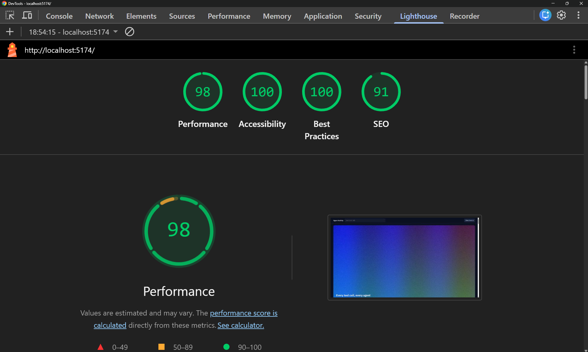

## Also noticed (left as is)

- The scroll highlight marks 5-6 rows at once because the band is 30-60% of the viewport. I kept it so before and after compare the same behaviour; highlighting only the row nearest the centre would be clearer.
- The dev server sends no cache headers. The server is outside `perf-clinic/`, so I did not change it.
- Search matches JSON key names, so "ok" or "latency" match almost every event. It is a correctness quirk, kept so results stay identical.
- The worker keeps the lowercase search text of all 100,000 events in memory to keep searches fast; a smaller index would change which queries match.
